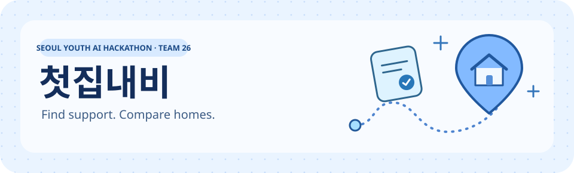

  

# 🏡 첫집내비

> 내 조건으로 찾는 주거 지원, 내 생활에 맞춰 고르는 첫 집.

서울에서 첫 독립을 준비하는 **만 19~39세 청년**을 위한 주거 의사결정 서비스입니다. 내 조건에 맞는 지원과 신청 시점을 확인하고, 직접 찾아둔 집 2~3곳을 월 주거비·통근·생활 편의로 비교합니다.

[🎨 Figma 시안](https://www.figma.com/design/FgI7qJqVSUHSHJVgzK7IeB/?node-id=264-9536) · [🧭 사용자 흐름](#사용자-흐름) · [🛠️ 기술 설계](#기술-스택) · [🚀 로컬 실행](#로컬-실행)

| 📝 내 조건 | 💌 받을 지원 | 🔑 집 고르기 |
| :--- | :--- | :--- |
| 나이·소득·예산·목적지 등 **9가지** 조건을 정리해요. | 자격과 신청 시점을 따로 보고, 궁금한 내용은 공고문 근거로 확인해요. | 후보 **2~3곳**의 월세·관리비, 출퇴근 시간, 주변 시설을 나란히 봐요. |

## 🧭 정연의 첫 독립

**박정연 · 27세 · 서울로 발령받은 사회초년생**

보증금으로 모아둔 돈은 **2,000만 원**, 월 소득은 **230만 원**, 목표 통근 시간은 **45분 이내**입니다. 성수·역삼·신림에서 집을 찾았지만, 공고문 속 ‘세대 분리’가 자신의 상황에 어떤 의미인지 궁금합니다.

1. **조건을 적어요.** 출근지로 멀티캠퍼스 역삼을 고르고, 현재 주소와 예산을 확인합니다. 쉬운 화면에서는 한 번에 한 질문씩 입력할 수 있습니다.
2. **신청할 수 있는 지원을 살펴봐요.** 자격, 접수 상태, 원문 근거를 확인하고, 아직 판단할 수 없는 조건은 ‘확인 필요’로 표시합니다.
3. **어느 집부터 볼지 정해요.** 월 주거비를 줄일지, 통근 시간을 아낄지에 따라 후보의 장단점을 비교합니다. 관리비를 모르는 집은 확인할 항목으로 남겨둡니다.

페르소나 보고서 v3의 정연 시나리오를 바탕으로 구성했습니다. 아래 비교표의 수치와 순위는 개정 서비스기획서 및 프로젝트 명세서 v2.0의 시연 예시를 따릅니다.

## 🌱 구현 현황

| 영역 | 현재 저장소 | 첨부 자료의 범위 |
| --- | --- | --- |
| 프론트엔드 | React 진입점, Vite 개발 서버와 `/api` 프록시. `App`은 빈 초기 화면 | Figma v4에 일반·쉬운 화면, 정책 질문, 후보 비교 및 텍스트 저장 시연 기록 |
| 백엔드 | Spring Boot 진입점, PostgreSQL 연결 설정, MyBatis·Flyway 의존성 | 세션 복원, 정책 판정, 후보 등록, 비교 및 질문 API 계약 |
| 데이터베이스 | PostgreSQL 18 Docker Compose, 영속 볼륨, 선택형 pgAdmin | ERD v0.5의 테이블 7개. Flyway 스키마 SQL은 구현 예정 |
| 정책 데이터 | 수집·정제 코드와 카탈로그 미포함 | 파이프라인 설명서에 정부24·LH·온통청년 수집과 정제 파일 출력까지 기록. DB 적재 및 서비스 조회 연동은 후속 범위 |

기능과 데이터 모델은 프로젝트 명세서 v2.0, API·ERD v0.5, 엔드포인트 명세서와 데이터 파이프라인 설명서를 기준으로 합니다. 로컬 실행 환경의 버전은 저장소의 설정을 따릅니다. [Figma v4 웹 화면](https://www.figma.com/design/FgI7qJqVSUHSHJVgzK7IeB/?node-id=264-9536)

## 🛠️ 기술 스택

| 영역 | 저장소 설정 |
| --- | --- |
| 프론트엔드 | Node.js 24, React 19, TypeScript 6, Vite 8, ESLint. React Router 8과 Zustand 5 의존성 선언 |
| 백엔드 | Java 17, Spring Boot 4.0.11-SNAPSHOT, Spring MVC, Bean Validation, Gradle Wrapper 9.9.2 |
| 영속성 | PostgreSQL 18, MyBatis Spring Boot Starter 4.0.1, Flyway, PostgreSQL JDBC |
| 로컬 인프라 | Docker Compose의 PostgreSQL, `tools` 프로필의 선택형 pgAdmin |

## 🗺️ 서비스 흐름과 시스템 구성

아래는 서버 연동 목표입니다. 브라우저는 같은 출처에서 `/api/v1`을 호출합니다. 로컬에서는 Vite가 `/api`를 Spring Boot로 전달합니다. 운영 환경에서도 `/api` 프록시를 SPA 페이지 대체 규칙보다 먼저 적용하는 설계입니다.

~~~mermaid
flowchart LR
    UI["React · 입력, 지도, 정책·비교 결과"] -->|"/api/v1"| API["Spring Boot · 세션, 검증, 판정, 계산"]
    API --> DB[("PostgreSQL · 사용자 입력, 정책, 비교 스냅샷")]
    API --> K["카카오 로컬 · 주소와 주변 시설"]
    API --> O["ODsay · 대중교통 경로와 요금"]
    API --> Q["근거 검색 및 LLM · 공고문 답변과 비교 설명"]
    KMAP["카카오 지도 JavaScript SDK"] -.-> UI
    DATA["정부24 · LH · 온통청년"] --> ETL["출처별 정제 및 카탈로그 출력"]
    ETL -.->|"DB 적재 연동 예정"| DB
    classDef app fill:#ede3ff,stroke:#8256aa,color:#312143
    classDef source fill:#e2f5ea,stroke:#4b846a,color:#213c31
    classDef storage fill:#fff0cd,stroke:#9f742e,color:#42311b
    class UI,API app
    class K,O,Q,KMAP,DATA source
    class DB,ETL storage
~~~

| 화면 | 설계 동작 |
| --- | --- |
| `/` | 시작 버튼을 누르면 회원가입 없이 주거 계획 세션을 생성합니다. |
| `/profile` | 출생연도, 직업·학업, 본인 명의 주택, 부모와 주소 동일 여부, 보증금 여력, 수입, 공통 목적지, 허용 이동 시간, 입주 시기를 확인합니다. 필수 조건이 갖춰지면 지원 조회로 이동합니다. |
| `/support` | 정책별 자격과 접수 상태, 기대 지원액과 근거를 표시합니다. 가정 계산과 공고문 질문도 여기서 실행합니다. |
| `/compare` | 집 주소 검색 → 주변 정보 미리보기 → 보증금·월세·관리비 확인 → 후보 A·B·C 저장 순서로 진행합니다. 후보 2~3곳이 준비되면 계산을 요청합니다. |
| `/compare/:comparisonId` | 저장된 비용·통근·시설·지원·순위 결과를 조회합니다. 우선순위 변경은 새 계산으로 이어지며, 사용자는 해당 비교의 이유를 질문하거나 ‘내 첫 집 파일’을 텍스트로 저장할 수 있습니다. |

`?mode=easy`는 같은 입력과 결과를 사용하는 쉬운 화면입니다. `/preview/:frameId`는 예시 데이터를 사용하는 시연 경로입니다. 서비스 범위는 지원 정보 안내와 사용자가 입력한 후보 비교입니다.

## 🔌 API 계약

아래 표에서 `{S}`는 `/api/v1/sessions/{sessionId}`입니다.

| 기능 | 메서드·경로 | 요청과 결과 |
| --- | --- | --- |
| 시작·복원 | `POST /api/v1/sessions`, `GET {S}` | 세션 생성 후 현재 조건, 후보, 입력 버전 및 최근 비교 참조를 복원합니다. |
| 주소 검색 | `POST {S}/location-search` | `DESTINATION` 또는 `HOME`으로 검색하고 선택 가능한 결과의 `locationId`를 받습니다. |
| 프로필 저장 | `PATCH {S}/profile` | 확인한 조건과 목적지를 저장하고 `revision`과 `canEvaluate`를 받습니다. |
| 현재 지원·가정 계산 | `GET {S}/policy-evaluation?inputRevision={revision}`, `POST {S}/policy-evaluations` | 현재 조건은 쿼리로 조회합니다. 가정 계산은 `inputRevision`과 `overrides`를 본문으로 받아 차이를 반환합니다. |
| 공고문 질문 | `POST {S}/policy-questions` | 답변과 근거 문장, 원문 링크를 반환합니다. |
| 후보 미리보기 | `POST {S}/home-previews` | 선택한 주소와 입력 버전으로 경로·시설을 조회하고 `previewId`를 반환합니다. |
| 후보 저장·삭제 | `PUT {S}/homes/{slot}`, `DELETE {S}/homes/{slot}` | 슬롯 1~3을 관리합니다. 저장 요청은 `previewId`와 계약 조건을 사용합니다. |
| 비교 생성·조회 | `POST {S}/comparisons`, `GET {S}/comparisons/{comparisonId}` | 생성은 `201`과 새 ID를 반환합니다. 조회는 저장된 비교표와 `isCurrent`를 반환합니다. |
| 우선순위·후속 질문 | `PATCH {S}/preferences`, `POST {S}/comparisons/{comparisonId}/questions` | 우선순위를 저장하면 최신 입력 버전으로 재계산합니다. 질문은 화면에 표시 중인 비교 ID를 사용합니다. |

- **세션 접근**은 세션 ID와 만료 토큰으로 확인합니다. 운영 쿠키 속성은 `HttpOnly`, `Secure`, `SameSite=Lax`이며 DB에는 토큰 해시를 저장합니다.
- **동시 수정**은 세션 `revision`과 `If-Match: "<revision>"`으로 검사합니다. 수정 요청에 헤더가 없으면 `428`, 버전이 다르면 `412`를 반환합니다. 계산·질의에 오래된 `inputRevision`이 오면 `409 STALE_INPUT`을 반환하고, 응답에는 실제 계산에 사용한 버전을 담습니다.
- **결과 복원**은 기존 `comparisonId`를 조회합니다. 입력 버전·판정일·규칙 버전·사용 정책이 바뀌면 `isCurrent: false`로 재계산을 안내합니다. `Idempotency-Key`를 사용하는 계산 재시도는 같은 세션·경로·키·요청의 결과를 재사용합니다.

## ⚖️ 정책 판정과 집 비교

| 항목 | 설계 규칙 |
| --- | --- |
| 지원 자격 | 정책 조건별 충족·불충족·확인 필요와 접수 상태를 각각 표시합니다. 생일 답변에 따라 만 나이 판정이 달라지고 답변이 비어 있으면 해당 연령 조건은 확인 필요로 표시합니다. |
| 지원 금액 | 확인된 중복 제한과 지급 방식을 적용합니다. 검증 가능한 금액이 없으면 `null`, 평가가 끝나 지급액이 0원이면 `0`입니다. 가정 계산은 저장 프로필과 별개로 수행합니다. |
| 월 주거비 | 지원 전 월세 + 관리비가 점수의 비용 기준입니다. 보증금 부족분은 따로 표시합니다. 관리비 미확인 후보는 ‘월세 + 관리비 별도’로 표시하고 순위를 보류합니다. 입력한 관리비 0원은 확인값으로 처리합니다. |
| 집별 지원 | 후보의 보증금·월세로 자격을 다시 평가합니다. 지원 적용 비용은 월 지원액을 실제 지급 기간에 한해 차감한 예시입니다. |
| 통근 | 후보에서 공통 목적지까지 대중교통 또는 도보 경로를 확인합니다. 편도 요금이 확인되면 월 참고 교통비는 편도 요금 × 2 × 20일로 계산해 주거비와 별도로 표시합니다. |
| 생활 편의 | 지하철역·대형마트·동네슈퍼·편의점·약국·내과·헬스장·공원 8종을 검색합니다. 2km 내 시설 미발견과 조회 실패를 구별하고 확보된 항목은 계속 표시합니다. |
| 종합 점수 | 비용·시간·생활 가중치는 균형 40/35/25, 돈 우선 60/25/15, 시간 우선 20/60/20, 동네 우선 30/20/50입니다. 지표를 점수로 환산하는 세부 산식과 정책별 판정 규칙표는 설계 보류 사항입니다. |

공고문 질의는 검증된 문단을 검색해 답변과 근거·원문 링크를 제공합니다. 근거를 확보하지 못하면 `NO_EVIDENCE`와 확인 방법을 반환합니다. 비교 질의는 해당 비교 스냅샷에 있는 값으로 설명하며, LLM의 출력이 계산값이나 결론과 어긋나면 코드가 생성한 설명을 사용합니다. 자격·금액·순위 결정은 정책 규칙과 계산 코드가 담당합니다.

### 비교 시연 예시

개정 서비스기획서의 시연은 만 27세, 월 소득 230만 원, 보증금 예산 2,000만 원, 목적지 멀티캠퍼스 역삼을 기준으로 합니다.

| 후보 | 월 주거비 | 편도 이동 | 균형 기준 결과 |
| --- | --- | --- | --- |
| A 성수 | 67만 원 | 30분 | 87점 · 1위 |
| B 역삼 | 100만 원 | 도보 13분 | 77점 · 2위 |
| C 신림 | 42만 원 + 관리비 별도 | 30분 | 관리비 확인 전 순위 보류 |

시연에서 성수의 월 주거비는 역삼보다 33만 원 낮고, 역삼의 편도 이동은 17분 짧습니다. 비교 답변이 이 차이를 정확히 설명하는지, 신림의 관리비를 확인하면 새 비교 결과가 생성되는지 검증합니다. 표의 점수는 기획서에 기록된 고정 시연값입니다.

## 🗃️ 정책 데이터와 저장 모델

파이프라인 문서의 처리 순서는 **API 수집 또는 기존 JSON 재처리 → 원본·실행 이력 보존 → 출처별 정제 → 관련성 검토 반영 → JSON·CSV와 실행 기록 출력**입니다.

| 출처 | 정제와 품질 관리 |
| --- | --- |
| 정부24 | ‘주거·자립’ 분야를 선별하고 서비스 ID로 서비스 목록과 지원조건을 연결합니다. 조건 코드의 표준 설명과 원본 값을 보존하고, 원본 해시가 바뀌면 검토대기로 돌립니다. |
| LH | 서울 임대주택·주거복지 공고를 변환합니다. 선택 수집한 공급정보와 개별 조회 실패를 원본에 보존하며, 공급정보의 세부 값 구조화는 후속 범위입니다. |
| 온통청년 | 페이지 단위로 수집하고 정책번호로 중복을 정리합니다. 페이지 요청이 실패하면 확보한 정책과 실패 페이지를 보존하고 부분 수집 상태를 기록합니다. |

공통 카탈로그 `policy_catalog.v3`는 출처와 정책 식별자, `benefit`, `application`, `eligibility`, 원문 링크 등 최상위 14개 필드를 사용합니다. 같은 정책 키에는 재실행해도 같은 ID를 부여합니다. `INCLUDE`·`REVIEW`·`EXCLUDE`는 데이터의 서비스 관련성을 나타내며, 개인 자격은 별도 정책 규칙으로 평가합니다.

| ERD 테이블 | 관계와 보존 정보 |
| --- | --- |
| `planning_sessions` | 주거 계획 단위. 토큰 해시, 판정일, 입력 버전, 우선순위, 접근성 설정을 보관합니다. |
| `profiles`, `frequent_places` | 세션당 각각 최대 1건. 확인한 사용자 조건과 공통 목적지를 보관합니다. |
| `candidate_homes` | 세션당 최대 3건. 슬롯, 주소와 보증금·월세·관리비를 보관합니다. |
| `policies`, `rag_chunks` | 정책과 그 근거 문단을 연결합니다. 문단에 원문 위치, 내용 해시, 문서 버전, 검증 상태를 기록합니다. |
| `comparison_runs` | 세션당 여러 건. 비교 시 사용한 입력·정책·결과 스냅샷, 판정일과 계산 규칙 버전을 보존합니다. |

## 🚀 로컬 실행

JDK 17, Node.js 24, Docker Compose가 필요합니다. 아래 명령은 저장소 루트에서 각 터미널을 시작하는 Windows PowerShell 기준입니다.

### PostgreSQL과 Spring Boot

~~~powershell
cd backend
Copy-Item .env.example .env
~~~

`backend/.env`의 `DB_PASSWORD`를 채웁니다. 기본 DB 이름은 `ai_youth_pjt_db`, 계정은 `postgres`입니다. Docker Compose와 Spring Boot는 같은 파일을 사용하므로 백엔드의 작업 디렉터리를 `backend`로 맞춥니다.

~~~powershell
docker compose up -d
docker compose ps
.\gradlew.bat bootRun
~~~

PostgreSQL이 `healthy` 상태인지 확인합니다. macOS·Linux에서는 파일 복사에 `cp .env.example .env`, 서버 실행에 `./gradlew bootRun`을 사용합니다.

### React 개발 서버

별도 터미널을 저장소 루트에서 엽니다.

~~~powershell
cd frontend
npm.cmd ci
npm.cmd run dev
~~~

macOS·Linux에서는 `npm ci`, `npm run dev`를 사용합니다. 지도 연동용 설정은 `frontend/.env.example`을 복사한 `frontend/.env`에 `VITE_KAKAO_JS_KEY`로 지정합니다. 카카오 REST·ODsay·LLM 키의 자리표시자는 `backend/.env.example`에 있습니다. 실제 키를 담은 `.env`는 커밋에서 제외합니다.

| 서비스 | 주소 |
| --- | --- |
| 프론트엔드 | `http://localhost:5173` |
| Spring Boot | `http://localhost:8080` |
| PostgreSQL | `localhost:5432` |
| pgAdmin | `http://localhost:5050` · `tools` 프로필 활성화 시 |

현재 골격에서 프론트 주소는 빈 화면을 표시하고, 백엔드의 루트 URL은 HTTP 404를 반환할 수 있습니다. 로컬 설정과 빌드 명령은 [백엔드 실행 가이드](backend/README.md)와 [프론트엔드 실행 가이드](frontend/README.md)에서 확인할 수 있습니다.
